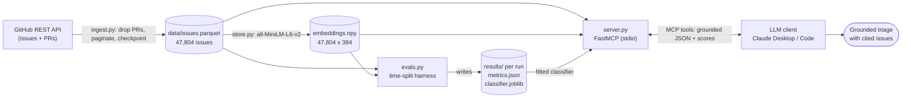
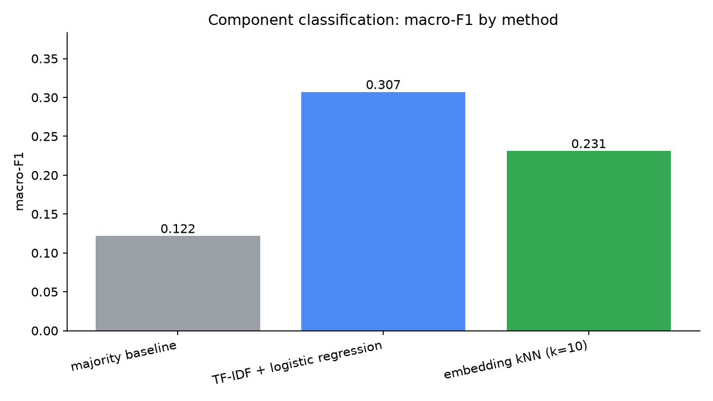
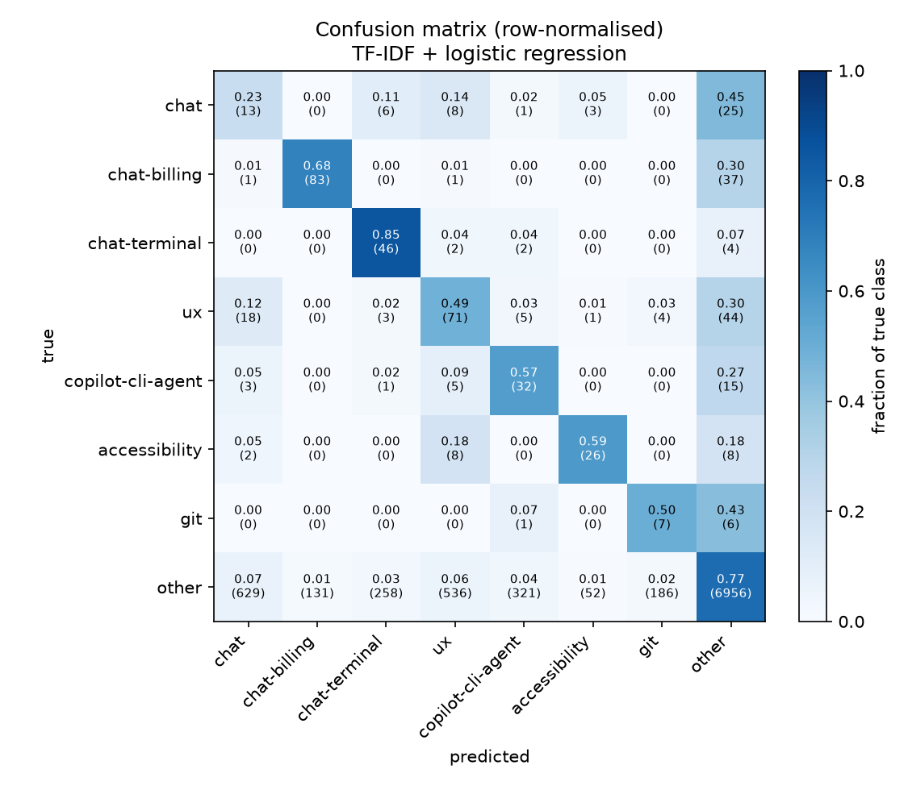

# triage-mcp

Issue triage for a busy GitHub repository is repetitive human work: for each new
issue, someone checks whether it duplicates an existing report and routes it to
the right component. **triage-mcp** turns a repository's history into a local
retrieval-and-classification service and exposes it to an LLM over the
[Model Context Protocol](https://modelcontextprotocol.io), so the model can
answer "has this been reported before?" and "which component owns this?" from
real evidence. The server itself makes no model calls — it returns retrieved
issues, similarity scores and predictions, each carrying the issue numbers it
was derived from, and the client's LLM does the reasoning.

Built as a one-day, local-first project: no Docker, no database server, no
managed vector store. State is Parquet, a NumPy matrix and a pickled
scikit-learn estimator on disk.

Every number in this README is produced by a single evaluation run and is
reproducible with `make eval` (seed `20260720`). The committed run lives in
[`results/20260720T201357Z/`](results/20260720T201357Z/).

---

## Architecture



Four stages, each its own module:

| Stage | Module | What it produces |
|---|---|---|
| **Ingest** | `ingest.py` | Harvests issues via the GitHub REST API, drops pull requests, paginates with per-page checkpointing, validates each record with Pydantic → `data/issues.parquet` |
| **Embed** | `store.py` | Encodes `title + body` with all-MiniLM-L6-v2, content-hash cached, row-aligned with the corpus → `data/embeddings.npy` |
| **Evaluate** | `evals.py` | Builds a time-split classification task, scores three methods and a retrieval proxy → `results/<ts>/` + the fitted classifier |
| **Serve** | `server.py` | Exposes six grounded tools over MCP/stdio; loads corpus, vectors and classifier lazily |

---

## Quickstart

Requires Python 3.11+ and [uv](https://docs.astral.sh/uv/).

```bash
make setup                                    # uv sync (pinned deps)
cp .env.example .env                          # add a GITHUB_TOKEN (raises the REST rate limit)

make ingest REPO=microsoft/vscode MAX=3000    # -> data/issues.parquet
make embed                                    # -> data/embeddings.npy  (content-hashed; re-runs are free)
make eval                                     # -> results/<ts>/ + data/classifier.joblib
make serve                                    # run the MCP server on stdio
```

The GitHub *list* endpoint caps at 10,000 items (~2 months for a repo this
busy). The committed corpus is a full year, harvested by walking creation-date
windows through the Search API:

```bash
uv run python -m triage_mcp.ingest --via search --since 2025-07-20
```

Other targets: `make stats` (corpus summary), `make smoke` (spawn the server and
exercise every tool), `make test`, `make lint`.

---

## Results

From [`results/20260720T201357Z/metrics.json`](results/20260720T201357Z/metrics.json).
Corpus: **47,804** microsoft/vscode issues, split by creation date into **38,243**
train (2025-07-20 → 2026-04-14) and **9,561** holdout (2026-04-14 → 2026-07-20).

### Component classification (holdout)

| method | accuracy | macro-F1 | weighted-F1 | p50 latency | p95 latency |
|---|---:|---:|---:|---:|---:|
| majority baseline | 0.9485 | 0.1217 | 0.9235 | — | — |
| **TF-IDF + logistic regression** | 0.7566 | **0.3070** | 0.8300 | 0.92 ms | 2.01 ms |
| embedding kNN (k=10) | 0.9407 | 0.2310 | 0.9274 | 4.97 ms | 6.84 ms |



**Read accuracy with suspicion here.** The majority baseline scores 0.9485
accuracy by predicting `other` for everything — because `other` is 9,069 of the
9,561 holdout issues (94.8%). Its macro-F1 is 0.1217. Macro-F1 is the honest
comparison metric, and by it, **TF-IDF + logistic regression (0.3070) is the
best method — more than double the majority baseline** and ahead of embedding
kNN (0.2310). Latency is measured per query, one at a time, as the model would
be served; it is hardware-dependent and not seeded, unlike the quality metrics.

Per-class F1 for the winning method shows *where* the signal is (full table in
[`summary.md`](results/20260720T201357Z/summary.md)): `chat-billing` 0.494 and
`accessibility` 0.413 are learnable; `chat` 0.036 is not — vscode spreads chat
work across many `chat-*` labels and applies the bare `chat` label
inconsistently, so it is a property of the label taxonomy, not the model.



### Retrieval proxy — label-match precision@5

> **This is a proxy, not a duplicate-detection rate.** It measures how often a
> retrieved neighbour shares the query's component class — *not* whether it is
> actually a duplicate. This corpus has no labelled duplicate pairs, so no
> duplicate metric can be computed directly. Two issues in the same component
> are usually not duplicates. Treat this as a *relative* signal for comparing
> retrieval methods.

| method | P@5 (all holdout) | P@5 (excl. `other`, n=492) | p50 latency | p95 latency |
|---|---:|---:|---:|---:|
| embeddings (all-MiniLM-L6-v2, exact cosine) | 0.8746 | **0.2122** | 4.71 ms | 6.02 ms |
| TF-IDF cosine | 0.8877 | 0.0959 | 160.65 ms | 203.58 ms |

The "all holdout" column is dominated by `other`-matching-`other` (noise
agreeing with noise), which is why TF-IDF looks marginally ahead there. On the
slice that means something — the 492 holdout issues that carry a real component
label — **dense embeddings are 2.2× better than TF-IDF** (0.2122 vs 0.0959), at
a fraction of the query latency (4.71 ms vs 160.65 ms p50). That gap is the case
for embeddings in this project.

---

## Methodology

**Time-based split.** The holdout is the most recent 20% of issues by creation
date; every training issue predates every holdout issue. The boundary is a
timestamp, not a row index, so issues sharing the boundary instant all fall on
the holdout side — no training issue is contemporaneous with a holdout one. A
random split would let the model learn from the future, and on issue trackers
that inflates scores badly, because label vocabulary and topics drift week to
week. A leakage-guard test asserts the separation, and embedding kNN restricts
its candidate pool to the training split via a boolean mask applied *before*
similarity is computed, so a holdout issue can never retrieve itself or a future
sibling.

**Task construction is a judgment call, made auditable.** GitHub labels mix
component/area (`terminal`, `git`), status (`info-needed`, `duplicate`), type
(`bug`, `feature-request`) and provenance (`ai-generated`). Only component
labels make a meaningful classification target, so the rest are excluded by an
explicit stoplist. Classes are the top-K component labels *ranked on the
training split only*; multi-label issues take their most frequent class;
everything else collapses to `other`. Classes with fewer than 10 holdout
examples are demoted to `other` before scoring — a class with two holdout issues
produces an F1 that swings wildly on a single prediction and would corrupt the
macro average. Here **7 of the 10 requested classes survived**; `chat-agents-view`
(416 train / 0 holdout), `chat-agent` (272/4) and `chat-prompts` (237/9) were
demoted. The complete mapping, stoplist and demotion log are written to
[`class_map.json`](results/20260720T201357Z/class_map.json).

**Three methods, weakest first.**
1. **Majority baseline** — always predict the most frequent training class. The
   floor that exposes how misleading accuracy is on an imbalanced corpus.
2. **TF-IDF + logistic regression** — bag-of-words (1–2 grams) with
   `class_weight="balanced"`, vectoriser fit on the training split only (fitting
   on the full corpus would leak holdout vocabulary and IDF weights).
3. **Embedding kNN** — cosine top-10 neighbours from the training split,
   majority vote.

**Metrics are computed, never asserted.** Everything comes from a run of
`evals.py` and is written to `results/<ts>/metrics.json`; nothing is hardcoded
or carried between runs. The classification quality metrics are deterministic
(seed `20260720`) and reproduce bit-for-bit; latency is not. `classify_component`
in the server reports the classifier's *measured* macro-F1, not a self-assessment.

---

## Using it from an LLM client

The server speaks MCP over stdio. It makes no LLM or network calls; every tool
returns typed, structured data with the supporting issue numbers.

| Tool | Returns |
|---|---|
| `corpus_info()` | Corpus size, date coverage, embedding model, classifier provenance and measured scores |
| `search_similar_issues(query, k=10)` | Ranked issues: number, title, labels, similarity, snippet |
| `find_duplicates(text, k=10, threshold=0.6)` | Candidates flagged above/below an (uncalibrated) threshold, with evidence snippets |
| `classify_component(text)` | Predictions from logreg **and** kNN, plus the neighbour issues behind the vote |
| `get_issue(number)` | Stored metadata for one issue |
| `triage(text)` | Duplicates + classification + every cited issue number, in one object |

Registration for **Claude Desktop** and **Claude Code** (verified against the
current docs): [docs/mcp-setup.md](docs/mcp-setup.md). In short, for Claude Code:

```bash
claude mcp add --scope local triage-mcp -- uv run python -m triage_mcp.server
```

### Demo — every tool over stdio (`make smoke`)

The smoke test spawns the server as a subprocess and drives it through the SDK
client, the same way a real client does. Abridged real output:

```text
corpus_info
  corpus_size: 47804   repos: ['microsoft/vscode']
  created_from: 2025-07-20 … created_to: 2026-07-20
  embedding_model: sentence-transformers/all-MiniLM-L6-v2   backend: sentence-transformers
  classifier_source_run: 20260720T201357Z   measured_macro_f1: 0.3069562629459519

search_similar_issues(query='terminal hangs during build', k=5)
  #314312  sim=0.6586  Window hang when searching in terminal   [bug, confirmation-pending, terminal-find]
  #265289  sim=0.6545  Terminal is hanging                      [info-needed]
  cited_issue_numbers: [314312, 265289, 265290, 292878, 314080]

classify_component(text=<new terminal-freeze issue>)
  logreg: 'chat-terminal' p=0.8304   (runner-up 'other' p=0.1092)
  kNN:    'other' vote=0.8000
  methods_agree: False          # the two methods disagree — surfaced, not hidden
  measured_quality: macro_f1=0.3070   (from run 20260720T201357Z)

triage(text=<new terminal-freeze issue>)
  duplicates above threshold: 10
  predicted component (logreg): 'chat-terminal'   (kNN): 'other'
  cited_issue_numbers: [259318, 265622, 267001, 268344, 271668, …]
  caveats: 2 attached
```

That `methods_agree: False` is the design working as intended: the server hands
the client both predictions and the evidence, rather than manufacturing a single
confident answer the data does not support.

<!-- Screenshots of the tools running inside Claude Desktop / Claude Code can be
     added under docs/img/ and linked here. They require a live client session,
     which is captured locally rather than checked in. -->

---

## Limitations & future work

This is a one-day build, and it is honest about what it is not:

- **No duplicate-pair ground truth.** The retrieval metric is a proxy. The right
  fix is to mine real duplicate pairs from issue timelines — vscode bots post
  `*duplicate` and "duplicate of #N" cross-references on close — and score
  precision/recall/MRR against those, turning `find_duplicates` from a heuristic
  into a measured capability.
- **No LLM reranking.** Retrieval is a single dense-cosine pass. A cross-encoder
  or an LLM reranker over the top-k would likely lift precision on the hard cases
  where lexical and semantic similarity disagree.
- **The client drives the loop manually.** A scripted agent loop that calls the
  tools, validates each response against its Pydantic schema, and emits a
  structured triage report would make the end-to-end capability testable in CI,
  independent of a human in a chat client.
- **In-memory exact search.** Brute-force cosine over ~48k × 384 is milliseconds
  and needs no index, which is the right call at this scale. Beyond a few hundred
  thousand issues, moving the corpus and vectors into Postgres + pgvector would
  keep it a single dependency while restoring sub-linear search.
- **Single repository.** The whole pipeline is `repo`-parameterised but only
  vscode is ingested and evaluated. Multi-repo evaluation — does a classifier
  trained on one repo transfer, or is triage inherently per-repo? — is the
  natural next experiment.

Some of these limitations are visible in the numbers above: `other` is 94.8% of
the corpus because most vscode issues carry no component label at all (13,026
are entirely unlabelled; another 30,696 have only status/type labels), which
caps how high macro-F1 can realistically go on this task.

---

## Project conventions

Type hints throughout; Pydantic for every record that crosses a boundary; unit
tests never touch the network (an autouse fixture blocks sockets, and the
server integration tests spawn a real subprocess pinned offline). See
[CLAUDE.md](CLAUDE.md) for the full set. Dependencies are pinned in
[pyproject.toml](pyproject.toml); `make lint` runs `ruff check` and
`ruff format --check`.

## License

[MIT](LICENSE).
